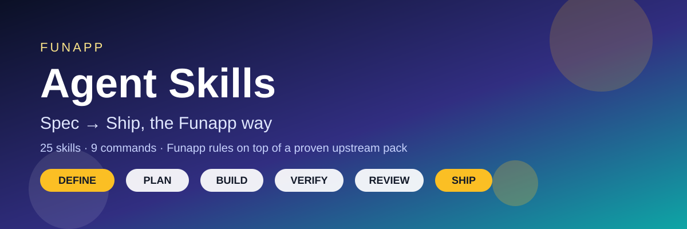
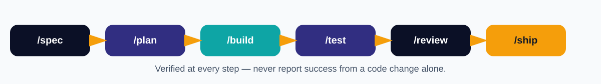

# Funapp Agent Skills v1

A Funapp adaptation of Addy Osmani's Agent Skills pack, built 2026-10-31 on the owner's go in this chat.

Credit and license: the upstream pack is MIT licensed by Addy Osmani (see `LICENSE` and `UPSTREAM_README.md`). This Funapp version keeps the upstream skill names, folders, commands, and shared references unchanged, and adds Funapp rules on top. It is not a claim that the upstream work is Funapp's original work.

## What is in this starter

- 25 skills in `skills/` — the full upstream set, copied verbatim except for the 8 core skills below.
- 9 slash commands in `commands/` — spec, plan, build, test, constraints, review, webperf, code-simplify, ship.
- Shared checklists in `references/` — upstream checklists plus `references/funapp-rules.md`.
- `references/funapp-rules.md` — a verbatim copy of Funapp Agent Pack v1 `rules/AGENT_RULES.md` (sections 1-7).

## Funapp-customized core skills (8)

These 8 keep their upstream name, folder, and frontmatter, but carry a short "Funapp Override" block at the top of each `SKILL.md`, pointing to `references/funapp-rules.md`:

1. spec-driven-development — spec must include tabbed pages, responsive PC + phone, Tech Stack, auth, test criteria, and the domain/hosting question; Burmese font + proofreader gate when Burmese is published.
2. planning-and-task-breakdown — milestones, one at a time, re-confirm before irreversible/external steps; domain and Myanmar-font questions as milestone gates.
3. incremental-implementation — one milestone at a time, test as you go, surgical changes only.
4. test-driven-development — failing check first when reproducible; report verified vs untested honestly.
5. code-review-and-quality — three-pass diff review (correctness, security, scope); security carve-out overrides simplicity/surgical rules.
6. shipping-and-launch — domain/hosting asked first; verify live on desktop and mobile before reporting live.
7. security-and-hardening — security carve-out: no known vulnerability left, no secrets in chat/code/memory, auth on every endpoint.
8. frontend-ui-engineering — responsive by default, tabbed sub-pages, rich visuals, visuals attached in chat (not link only), Myanmar font asked first, Burmese proofread before publishing.

The other 17 skills are upstream verbatim in this starter. They still work, and they can be given the same override treatment in a later batch (documentation-and-adrs and browser-testing-with-devtools are the natural next two).

## Note on AGENTS.md in this folder

The `AGENTS.md` file copied with the upstream repo is guidance for agents working on the upstream repo itself, not a Funapp global configuration. The reusable Funapp rules for projects are in `references/funapp-rules.md`; the reusable assets are the skills in `skills/`.

## How to use this pack locally

This starter is built locally only. It has NOT been published to GitHub, and it has NOT been deployed to Ko Pai or Cursor — those need the owner's separate go.

- Any agent (Cursor, Codex, others): install from this folder with the skills CLI, for example `npx skills add <path-to-this-folder>`, then restart the agent.
- Claude Code: install as a plugin from your own fork once this folder is published to GitHub as `funapp-agent-skills`; until then, use the local folder path.
- Muse (this chat): the method is already in use — ask stepwise (spec, plan, build, test, review, ship) and the Funapp rules in `references/funapp-rules.md` are the same rules as Funapp Agent Pack v1.

After install, test on a small project first: run `/spec` for a small feature and check that the spec includes responsive, tabbed pages, stack, auth, test criteria, and the domain question. If a section is missing, the override was not picked up — check the skill's frontmatter and the override block, not the upstream body.

## Note on the upstream workflow file

The upstream `.github/workflows/test-plugin-install.yml` file is kept in the local folder but is NOT pushed to GitHub in this publish: the GitHub token used here returns 403 "Resource not accessible by personal access token" for workflow files, the same limit seen before with workflow uploads. The skills, commands, and references do not need that workflow file to work. If the workflow is wanted on GitHub, add that one file manually through the GitHub web UI (repo → Add file → Upload files).

## What is NOT done yet

- GitHub fork / publish as `mymyanmarland/funapp-agent-skills` — needs a separate go, and at publish time `plugin.json` name/repository should be updated from the upstream values kept here.
- Ko Pai deployment — needs a separate go and the two-phase sync used for Funapp Agent Pack v1.
- Cursor per-project install — the owner installs from this folder into their own Cursor projects, or asks Muse to prepare a per-project file.
- Next customization batch — documentation-and-adrs, browser-testing-with-devtools, and any new Funapp-only skills (for example a VPS deploy check skill).

## Upstream maintenance

Upstream source for this starter: Addy Osmani `agent-skills`, short commit `eb07f19` (cloned 2026-10-31). To pull later upstream changes into a fork, add the upstream remote and merge; because Funapp changes live in short override blocks and in `references/funapp-rules.md`, conflicts should stay small. Do not rename upstream skill folders or frontmatter names without also updating `commands/*.toml` and `plugin.json` together, and re-testing the slash commands.
