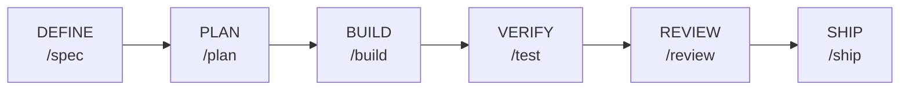
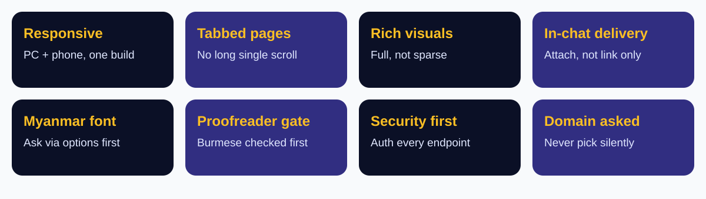

<p align="center">
  
  
  
  
  
</p>

<p align="center"><b>Spec first. Test as you go. Review twice. Ship with proof.</b><br/>
A Funapp adaptation of Addy Osmani's Agent Skills pack — the same proven spec-to-ship workflow, with Funapp rules layered on top.</p>


## 👀 See it in action



No shortcuts. The agent writes a spec, splits the plan, builds one milestone at a time, runs tests, reviews the diff, checks security, verifies live — and only then ships.


## 🔄 The lifecycle




| Phase | Command | What happens |
|---|---|---|
| DEFINE | `/spec` | Write the spec before any code. Pages, stack, auth, tests, domain question. |
| PLAN | `/plan` | Split work into milestones, one at a time, each with a verification step. |
| BUILD | `/build` | Build incrementally. Surgical changes only, matching existing style. |
| VERIFY | `/test` | Failing check first when reproducible. Run the project's own tests. |
| REVIEW | `/review` | Three-pass diff review: correctness, security, scope. Nothing unasked. |
| SHIP | `/ship` | Domain/hosting asked, deploy verified live on desktop + mobile, then report. |


## 🎯 Funapp-customized core skills (8)

These 8 keep their upstream name, folder, and frontmatter, but carry a short **Funapp Override** block at the top of each `SKILL.md`, pointing to `references/funapp-rules.md`:

| Skill | Funapp difference |
|---|---|
| `spec-driven-development` | Spec must include tabbed pages, responsive PC + phone, Tech Stack, auth, test criteria, domain question; Burmese font + proofreader gate when Burmese is published. |
| `planning-and-task-breakdown` | Milestones one at a time, re-confirm before irreversible/external steps; domain and Myanmar-font questions as milestone gates. |
| `incremental-implementation` | One milestone at a time, test as you go, surgical changes only. |
| `test-driven-development` | Failing check first when reproducible; report verified vs untested honestly. |
| `code-review-and-quality` | Three-pass review; security carve-out overrides simplicity/surgical rules. |
| `shipping-and-launch` | Domain/hosting asked first; verify live on desktop + mobile before reporting live. |
| `security-and-hardening` | No known vulnerability left, no secrets in chat/code/memory, auth on every endpoint. |
| `frontend-ui-engineering` | Responsive by default, tabbed sub-pages, rich visuals, visuals attached in chat (not link only), Myanmar font asked first, Burmese proofread before publishing. |



The other 17 skills are upstream verbatim in this starter and still work. The natural next batch is `documentation-and-adrs` and `browser-testing-with-devtools`.


## 📚 Full skill catalog (25)

**Define & Plan:** `spec-driven-development` · `planning-and-task-breakdown` · `idea-refine` · `interview-me` · `context-engineering` · `source-driven-development`

**Build:** `incremental-implementation` · `frontend-ui-engineering` · `api-and-interface-design` · `constraint-driven-development` · `doubt-driven-development`

**Verify:** `test-driven-development` · `debugging-and-error-recovery` · `performance-optimization` · `browser-testing-with-devtools` · `observability-and-instrumentation`

**Review & Ship:** `code-review-and-quality` · `code-simplification` · `security-and-hardening` · `shipping-and-launch` · `ci-cd-and-automation` · `git-workflow-and-versioning` · `deprecation-and-migration` · `documentation-and-adrs` · `using-agent-skills`

**Commands (9):** `spec` · `plan` · `build` · `test` · `constraints` · `review` · `webperf` · `code-simplify` · `ship`


## 🚀 Install

```bash
# Any agent (Cursor, Codex, others) — skills CLI
npx skills add mymyanmarland/funapp-agent-skills
```

Then restart the agent. Claude Code: add this repo as a plugin marketplace (`funapp-agent-skills`).

Test on a small project first:

```bash
/spec   # for a small feature — check the spec includes responsive, tabbed pages,
        # stack, auth, test criteria, and the domain question
```

If a section is missing, the override was not picked up — check the skill's frontmatter and override block, not the upstream body.

## ⚠️ Notes

- **Credit & license:** Upstream pack is MIT licensed by Addy Osmani (see `LICENSE` and `UPSTREAM_README.md`). This Funapp version keeps upstream skill names, folders, commands, and shared references unchanged, and adds Funapp rules on top. It is not a claim that the upstream work is Funapp's original work.
- **Workflow file omitted from GitHub:** The upstream `.github/workflows/test-plugin-install.yml` is kept locally but NOT pushed to GitHub — the GitHub token returns 403 for workflow files. Skills, commands, and references do not need it. Add that one file manually via the GitHub web UI if wanted.
- **Not deployed to Ko Pai or Cursor yet** — those need the owner's separate go.
- **AGENTS.md in this folder:** That file is guidance for agents working on the upstream repo itself, not a Funapp global configuration. Funapp rules live in `references/funapp-rules.md`; reusable assets are the skills in `skills/`.
- **Upstream maintenance:** Upstream source is Addy Osmani `agent-skills`, short commit `eb07f19` (cloned 2026-10-31). Funapp changes live in short override blocks and `references/funapp-rules.md`, so later upstream merges should stay small. Do not rename upstream skill folders or frontmatter names without also updating `commands/*.toml` and `plugin.json` together, and re-testing the slash commands.


